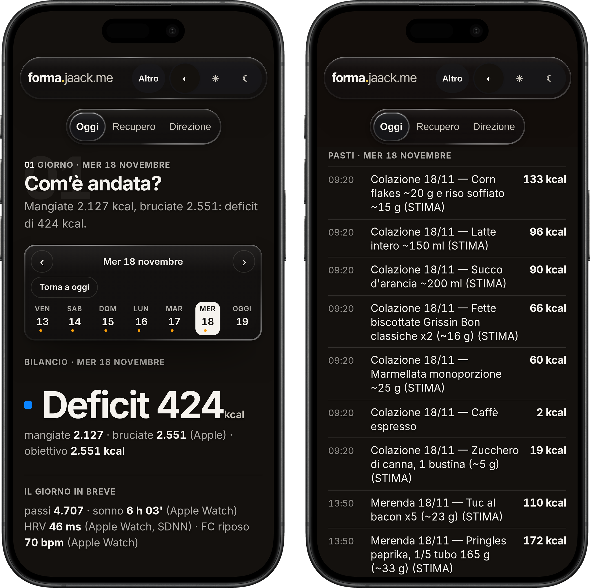
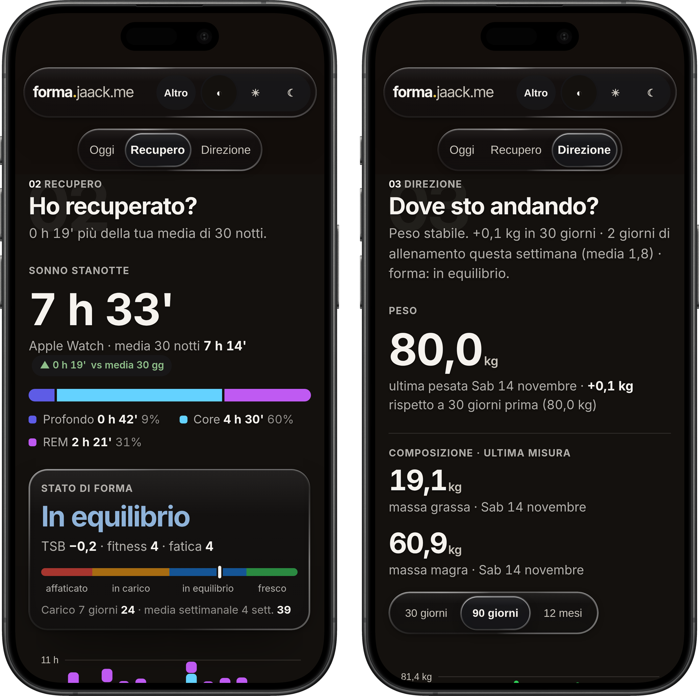



Mi capitava di stare in cucina a indovinare i grammi della pasta, o di tornare da un allenamento e aprire tre app diverse per ricostruire la giornata. I pasti restavano a metà in un'app di note, e stimare calorie e macro a mano era noioso. Volevo qualcosa che si adattasse al mio calendario, e che tenesse i dati di salute su un'infrastruttura mia.

Ho costruito Forma, un coach privato in Grok Bot, con una dashboard sul mio Cloudflare e un'app che legge Apple Health. Gli mando una foto del pranzo e mi torna una stima, gli chiedo cosa mangiare prima del tennis, e la sera do un'occhiata alla dashboard.

Ora ho pubblicato un template del bot. Lo puoi installare sul tuo account e usarlo allo stesso modo, con i tuoi dati sul tuo Cloudflare. Spiego cos'è, come si installa, come si mette in piedi la dashboard e Forma Sync, e dove restano i dati.

<figure class="forma-figure">
  
  <figcaption>Apple Health arriva da Forma Sync, i pasti dal bot in Grok Bot. Entrambi finiscono nel Worker Cloudflare con D1, e la dashboard, protetta da password, li legge da lì.</figcaption>
</figure>

## Cos'è Forma

Forma è un coach privato di alimentazione e allenamento. Gli parli in chat, in italiano o nella lingua che scegli alla prima conversazione.

Ti tiene il diario dei pasti. Puoi mandare una foto del piatto, un menu, uno scontrino, oppure descrivere quello che hai mangiato. Forma stima calorie, proteine, grassi, carboidrati e fibre, e marca le stime come tali. Se correggi un pasto, aggiorna la voce esistente, senza crearne una seconda.

<figure class="forma-figure">
  
  <figcaption>Se correggi un pasto già registrato, Forma aggiorna la stessa voce, senza crearne una seconda.</figcaption>
</figure>

Prepara piani pasti e una lista della spesa, con un budget che gli dici tu. Propone allenamenti adatti al tuo calendario. Puoi attivare dei promemoria per i pasti: restano in pausa finché non glielo chiedi tu. Per i piani e i record di decisione può usare una knowledge base a tua scelta.

I target giornalieri sono dinamici. Quando la dashboard e l'app di sync sono collegate, le calorie del giorno seguono la spesa energetica misurata da Apple Health. Proteine, grassi, carboidrati e fibre li imposti tu, oppure Forma calcola dei valori provvisori, da far confermare a un professionista. I riferimenti di partenza, come esempio e non come prescrizione, sono circa 1,6-2 g di proteine per chilo di peso, grassi al 25-30% delle calorie, e 30 g di fibre.

<figure class="forma-figure">
  
  <figcaption>Esempio su una giornata da 2.400 kcal. Non è un consiglio e non sono i miei target: le proteine le imposti tu, i grassi sono al 25% (dentro il 25-30%), i carboidrati sono il resto, le fibre un obiettivo a parte da 30 g.</figcaption>
</figure>

## Come iniziare

Il template del bot si installa da Grok Bot: [Forma su Grok Bot](https://x.ai/bot/9BQ5_crcU9xahngP02wd8).

Alla prima conversazione Forma ti guida, una domanda alla volta:

1. Come vuoi chiamarlo, e in che lingua deve scrivere.
2. Il profilo: data di nascita, altezza, peso, obiettivo.
3. Vincoli alimentari e, se ce l'hai, il piano di un nutrizionista.
4. Allenamento, eventuali limiti fisici, e se usi un'app come Hevy.
5. Integratori.
6. Orari abituali dei pasti.
7. Dove fai la spesa, il budget, per quante persone.
8. Una knowledge base, se vuoi usarla.
9. Il calendario, in sola lettura.
10. L'email, anch'essa in sola lettura.

Poi salva il profilo, calcola i target provvisori e crea le routine dei promemoria, lasciandole in pausa. Il diario parte dal primo pasto che gli mandi.

Quando la dashboard è pronta, gli dai l'indirizzo del sito e salvi `INGEST_SECRET` come secret del bot, mai nel testo della chat.

<figure class="forma-figure">
  
  <figcaption>I sei passi, dall'installazione del bot alla prima sincronizzazione.</figcaption>
</figure>

## La dashboard sul tuo Cloudflare

Il diario e i dati di Salute stanno su un sito tuo, servito da un Worker Cloudflare con un database D1 nel tuo account. Il template è pubblico, senza cartelle cliniche né credenziali: [forma-dashboard-template](https://github.com/iJaack/forma-dashboard-template). L'accesso è protetto da password.

Servono un account Cloudflare con Workers e D1, Node.js 20 o successivo (il README consiglia 22.13+, ed è la versione richiesta per i test SQLite inclusi), npm e Git. Python non serve.

I comandi, come nel README del template:

```sh
npm install
npx wrangler login
npx wrangler d1 create forma-health
cp wrangler.example.toml wrangler.toml
```

Copi in `wrangler.toml` il `database_id` stampato da `d1 create`, scegli un nome del Worker che ti appartiene, e allinei `database_name`. Poi crei lo schema vuoto e imposti i tre secret, ciascuno al proprio prompt, senza metterli nel file TOML né nel codice:

```sh
npm run db:migrate:remote
npx wrangler secret put SITE_PASSWORD
npx wrangler secret put SESSION_KEY
npx wrangler secret put INGEST_SECRET
```

Per `SESSION_KEY` e `INGEST_SECRET` il README suggerisce, come esempio, `openssl rand -base64 48`. Conserva i valori nel tuo gestore di password. Poi:

```sh
npm run deploy
```

L'indirizzo predefinito è `https://<name>.<tuo-subdomain>.workers.dev`. Se vuoi un dominio tuo, decommenti il blocco `routes` in cima a `wrangler.toml` e sostituisci `dash.example.com` con il tuo dominio: la zona DNS deve appartenere al tuo account. In alternativa, aggiungi il dominio da Workers → Settings → Domains & Routes, e fai di nuovo il deploy.

Dal telefono la stessa interfaccia si legge in una colonna sola, come nelle schermate iPhone qui sotto.

Le schermate qui sotto sono la mia dashboard su [forma.jaack.me](https://forma.jaack.me/). Sono dati reali, usati come riferimento visivo. Il template riproduce la stessa interfaccia, vuota, sul tuo account.

<figure class="forma-figure forma-screens">
  
  <figcaption>A sinistra la vista Oggi, a destra il diario dei pasti, su forma.jaack.me.</figcaption>
</figure>

I dettagli, i test con dati sintetici e le variabili opzionali sono nel [README del template](https://github.com/iJaack/forma-dashboard-template#readme). Se qualcosa in questa pagina e nel README non coincidono, vale il README.

## Forma Sync, l'app per iPhone

Per mandare i dati di Apple Health alla dashboard c'è Forma Sync. La compili tu sul Mac con Xcode e la installi sul telefono, senza TestFlight. Il codice è pubblico: [forma-sync](https://github.com/iJaack/forma-sync). La guida completa è in [`docs/INSTALL-XCODE.md`](https://github.com/iJaack/forma-sync/blob/main/docs/INSTALL-XCODE.md).

Servono un Mac con Xcode, un iPhone con iOS 17 o successivo, un Apple ID (anche gratuito), Homebrew, e una dashboard già funzionante. Poi, dal Terminale:

```bash
brew install xcodegen
git clone https://github.com/iJaack/forma-sync.git
cd forma-sync
cp Config/Local.xcconfig.example Config/Local.xcconfig
```

In `Config/Local.xcconfig` inserisci il tuo Team ID e un bundle ID unico, per esempio `com.tuonome.formasync`. Quel file resta sul tuo Mac e Git lo ignora. Poi:

```bash
xcodegen generate
open FormaSync.xcodeproj
```

In Xcode scegli lo schema FormaSync e il tuo iPhone, controlli la firma in Signing & Capabilities, e lasci attivo Automatically manage signing. Sul telefono attivi la Modalità sviluppatore (Impostazioni → Privacy e sicurezza) e, se iOS lo chiede, autorizzi lo sviluppatore in Impostazioni → Generali → VPN e gestione dispositivi. Premi ▶, apri l'app e consenti l'accesso a Salute. Forma Sync legge soltanto: non scrive in Apple Health.

Con un Apple ID gratuito (Personal Team) il profilo di sviluppo scade dopo 7 giorni. L'app smette di aprirsi e non sincronizza più, finché non ricolleghi l'iPhone e premi di nuovo ▶ in Xcode, con lo stesso team e lo stesso bundle ID. Con l'Apple Developer Program il profilo dura un anno.

<figure class="forma-figure">
  
  <figcaption>Con un Apple ID gratuito il profilo scade al settimo giorno: ricolleghi l'iPhone e premi ▶ in Xcode, con lo stesso team e lo stesso bundle ID.</figcaption>
</figure>

Per collegare la dashboard, in app vai su Configura connessione. Puoi incollare o scansionare un QR con questo JSON, sostituendo i segnaposto in locale e senza condividere il file:

```json
{
  "url": "https://<tuo-sito>/api/ingest/health",
  "client_id": "unused",
  "client_secret": "unused",
  "bearer": "<INGEST_SECRET>"
}
```

`url` deve usare https. Se indichi solo la radice del sito, l'app aggiunge `/api/ingest/health`. `bearer` è lo stesso `INGEST_SECRET` impostato sul Worker, senza le parentesi. `client_id` e `client_secret` devono essere presenti: `unused` va bene quando la dashboard chiede soltanto il bearer.

Dopo il salvataggio, premi Prova connessione. Poi, con l'iPhone sbloccato e l'app aperta, premi Sincronizza ora e controlla i giorni recenti sulla tua dashboard, dopo aver fatto il login. Sonno, HRV e frequenza cardiaca a riposo arrivano da Apple Health e si vedono nel capitolo Recupero.

Nel tempo la dashboard accumula anche il capitolo Direzione: peso, bilancio medio e costanza degli allenamenti.

<figure class="forma-figure forma-screens">
  
  <figcaption>A sinistra il capitolo Recupero, dopo i dati di Apple Health; a destra il capitolo Direzione.</figcaption>
</figure>

Non usare generatori QR online: la configurazione contiene un segreto. I comandi per creare il QR in locale, e i casi più comuni di errore, sono nella guida di installazione.

## Privacy, e un avviso

I dati di salute e il diario dei pasti restano nel tuo account Cloudflare. Il template della dashboard non contiene cartelle cliniche, cronologia dei pasti o credenziali. Non ha analytics, né export verso terzi, né font esterni.

Il bot non invia messaggi, non pubblica e non attiva nulla da solo. Il calendario, se lo colleghi, è in sola lettura. L'email, se la colleghi, è anch'essa in sola lettura.

Forma non è un medico. Le stime dei pasti e i target provvisori servono a tenerti organizzato. Le decisioni su dieta, integrazione e allenamento restano tue, e conviene farle confermare a un professionista.

Le schermate di questa guida arrivano da forma.jaack.me, la mia istanza, e servono solo a mostrare l'interfaccia. Il sito è protetto da password: non è un servizio condiviso a cui registrarsi.

## Domande brevi

**Devo per forza avere un dominio?** No. Puoi usare l'indirizzo `workers.dev` che Cloudflare ti assegna.

**Devo pagare Apple per installare l'app?** No. Con un Apple ID gratuito l'app si installa da Xcode. Il limite è la scadenza del profilo dopo 7 giorni, e al massimo tre app con provisioning gratuito sul dispositivo.

**Serve TestFlight?** No. Compili l'app da Xcode e la installi sul tuo iPhone.

**Posso correggere un pasto già registrato?** Sì. Diglielo: aggiorna la voce esistente, non ne crea una seconda.

**I promemoria arrivano da soli?** No. Restano in pausa finché non li attivi tu.

**Dove sono i dettagli tecnici?** Nel [README del template della dashboard](https://github.com/iJaack/forma-dashboard-template#readme) e in [`docs/INSTALL-XCODE.md`](https://github.com/iJaack/forma-sync/blob/main/docs/INSTALL-XCODE.md) di Forma Sync. Per il formato con cui il bot scrive i pasti c'è anche [`docs/forma-agent.md`](https://github.com/iJaack/forma-dashboard-template/blob/main/docs/forma-agent.md).

Il punto di partenza è il [template del bot](https://x.ai/bot/9BQ5_crcU9xahngP02wd8), insieme a quei due repository. Se dopo l'installazione qualcosa non torna, parti da lì.
