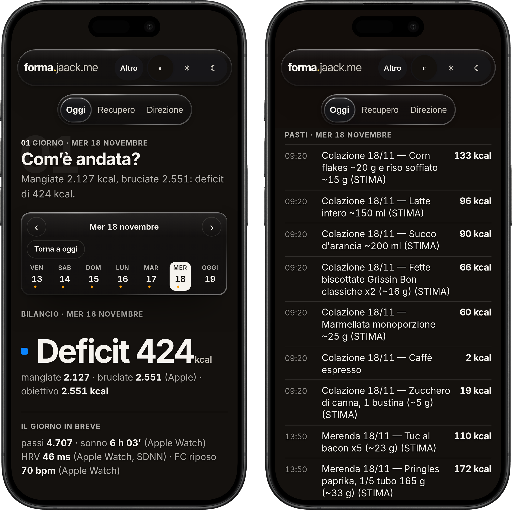
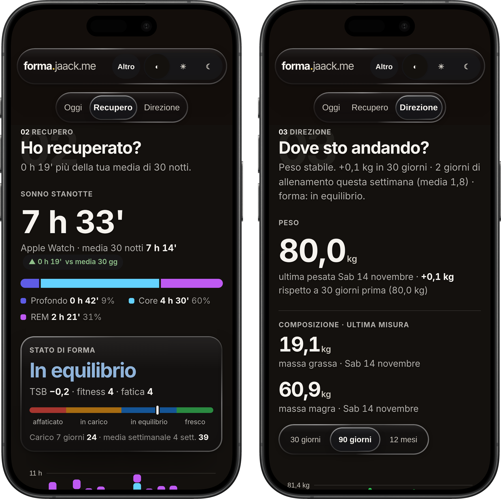



I'd find myself in the kitchen trying to guess how many grams of pasta were in the pot, or coming back from a workout and opening three different apps to reconstruct the day. Meals sat half-logged in a notes app, and estimating calories and macros by hand was tedious. I wanted something that would fit my calendar, and keep health data on my own infrastructure.

I built Forma, a private coach in Grok Bot, with a dashboard on my Cloudflare account and an app that reads Apple Health. I send it a photo of lunch and get an estimate back, I ask what to eat before tennis, and in the evening I glance at the dashboard.

I've now published a template of the bot. You can install it on your account and use it the same way, with your data on your Cloudflare account. I cover what it is, how to install it, how to set up the dashboard and Forma Sync, and where the data stays.

<figure class="forma-figure">
  
  <figcaption>Apple Health arrives through Forma Sync, meals through the bot in Grok Bot. Both end up in the Cloudflare Worker and D1, and the password-protected dashboard reads from there.</figcaption>
</figure>

## What Forma is

Forma is a private nutrition and training coach. You talk to it in chat, in Italian or in the language you choose in the first conversation.

It keeps your meal diary. You can send a photo of the plate, a menu, a receipt, or describe what you ate. Forma estimates calories, protein, fat, carbs and fiber, and marks those numbers as estimates. If you correct a meal, it updates the existing entry, without creating a second one.

<figure class="forma-figure">
  
  <figcaption>If you correct a meal that's already logged, Forma updates the same entry, without creating a second one.</figcaption>
</figure>

It prepares meal plans and a shopping list, with a budget you give it. It suggests workouts that fit your calendar. You can turn on meal reminders: they stay paused until you ask. For plans and decision records it can use a knowledge base of your choice.

Daily targets are dynamic. When the dashboard and the sync app are connected, the day's calories follow energy expenditure measured by Apple Health. You set protein, fat, carbs and fiber yourself, or Forma calculates provisional values, for a professional to confirm. Starting references, as an example and not a prescription, are about 1.6-2 g of protein per kilogram of body weight, fat at 25-30% of calories, and 30 g of fiber.

<figure class="forma-figure">
  
  <figcaption>An example day of 2,400 kcal. This is not advice, and these are not my targets: you set protein, fat is at 25% (within the 25-30% range), carbs fill the remainder, and fiber is a separate 30 g target.</figcaption>
</figure>

## How to get started

The bot template is installed from Grok Bot: [Forma on Grok Bot](https://x.ai/bot/9BQ5_crcU9xahngP02wd8).

In the first conversation Forma walks you through, one question at a time:

1. What you want to call it, and which language it should write in.
2. Your profile: date of birth, height, weight, goal.
3. Dietary constraints and, if you have one, a nutritionist's plan.
4. Training, any physical limits, and whether you use an app like Hevy.
5. Supplements.
6. Usual meal times.
7. Where you shop, the budget, and for how many people.
8. A knowledge base, if you want to use one.
9. Your calendar, read-only.
10. Your email, also read-only.

Then it saves the profile, calculates provisional targets and creates the reminder routines, leaving them paused. The diary starts with the first meal you send.

When the dashboard is ready, you give it the site address and save `INGEST_SECRET` as a bot secret, never in the chat text.

<figure class="forma-figure">
  
  <figcaption>The six steps, from installing the bot to the first sync.</figcaption>
</figure>

## The dashboard on your Cloudflare

The diary and Health data live on a site of yours, served by a Cloudflare Worker with a D1 database in your account. The template is public, with no medical records or credentials: [forma-dashboard-template](https://github.com/iJaack/forma-dashboard-template). Access is password-protected.

You need a Cloudflare account with Workers and D1, Node.js 20 or later (the README recommends 22.13+, and that's the version required for the included SQLite tests), npm and Git. Python is not required.

The commands, as in the template README:

```sh
npm install
npx wrangler login
npx wrangler d1 create forma-health
cp wrangler.example.toml wrangler.toml
```

You copy the `database_id` printed by `d1 create` into `wrangler.toml`, choose a Worker name that belongs to you, and align `database_name`. Then you create the empty schema and set the three secrets, each at its own prompt, without putting them in the TOML file or in the code:

```sh
npm run db:migrate:remote
npx wrangler secret put SITE_PASSWORD
npx wrangler secret put SESSION_KEY
npx wrangler secret put INGEST_SECRET
```

For `SESSION_KEY` and `INGEST_SECRET` the README suggests, as an example, `openssl rand -base64 48`. Keep the values in your password manager. Then:

```sh
npm run deploy
```

The default address is `https://<name>.<your-subdomain>.workers.dev`. If you want your own domain, uncomment the `routes` block at the top of `wrangler.toml` and replace `dash.example.com` with your domain: the DNS zone must belong to your account. Alternatively, add the domain from Workers → Settings → Domains & Routes, and deploy again.

On a phone the same interface reads as a single column, like the iPhone screenshots below.

The screenshots below are my dashboard at [forma.jaack.me](https://forma.jaack.me/). They're real data, used as a visual reference. The template reproduces the same interface, empty, on your account.

<figure class="forma-figure forma-screens">
  
  <figcaption>On the left, the Oggi view; on the right, the meal diary, on forma.jaack.me.</figcaption>
</figure>

Details, tests with synthetic data and optional variables are in the [template README](https://github.com/iJaack/forma-dashboard-template#readme). If this page and the README disagree, the README wins.

## Forma Sync, the iPhone app

To send Apple Health data to the dashboard there's Forma Sync. You build it yourself on a Mac with Xcode and install it on the phone, without TestFlight. The code is public: [forma-sync](https://github.com/iJaack/forma-sync). The full guide is in [`docs/INSTALL-XCODE.md`](https://github.com/iJaack/forma-sync/blob/main/docs/INSTALL-XCODE.md).

You need a Mac with Xcode, an iPhone running iOS 17 or later, an Apple ID (a free one is fine), Homebrew, and a dashboard that's already working. Then, from Terminal:

```bash
brew install xcodegen
git clone https://github.com/iJaack/forma-sync.git
cd forma-sync
cp Config/Local.xcconfig.example Config/Local.xcconfig
```

In `Config/Local.xcconfig` you enter your Team ID and a unique bundle ID, for example `com.yourname.formasync`. That file stays on your Mac and Git ignores it. Then:

```bash
xcodegen generate
open FormaSync.xcodeproj
```

In Xcode you choose the FormaSync scheme and your iPhone, check signing in Signing & Capabilities, and leave Automatically manage signing on. On the phone you turn on Developer Mode (Settings → Privacy & Security) and, if iOS asks, trust the developer in Settings → General → VPN & Device Management. Press ▶, open the app and allow access to Health. Forma Sync only reads: it does not write to Apple Health.

With a free Apple ID (Personal Team) the development profile expires after 7 days. The app stops opening and no longer syncs, until you reconnect the iPhone and press ▶ in Xcode again, with the same team and the same bundle ID. With the Apple Developer Program the profile lasts a year.

<figure class="forma-figure">
  
  <figcaption>With a free Apple ID the profile expires on day 7: reconnect the iPhone and press ▶ in Xcode, with the same team and the same bundle ID.</figcaption>
</figure>

To connect the dashboard, in the app go to Configura connessione. You can paste or scan a QR with this JSON, replacing the placeholders locally and without sharing the file:

```json
{
  "url": "https://<your-site>/api/ingest/health",
  "client_id": "unused",
  "client_secret": "unused",
  "bearer": "<INGEST_SECRET>"
}
```

`url` must use https. If you only give the site root, the app appends `/api/ingest/health`. `bearer` is the same `INGEST_SECRET` set on the Worker, without the brackets. `client_id` and `client_secret` must be present: `unused` is fine when the dashboard only asks for the bearer.

After saving, press Prova connessione. Then, with the iPhone unlocked and the app open, press Sincronizza ora and check recent days on your dashboard, after logging in. Sleep, HRV and resting heart rate come from Apple Health and show up in the Recupero chapter.

Over time the dashboard also fills the Direzione chapter: weight, average balance and training consistency.

<figure class="forma-figure forma-screens">
  
  <figcaption>On the left, the Recupero chapter, after Apple Health data; on the right, the Direzione chapter.</figcaption>
</figure>

Don't use online QR generators: the configuration contains a secret. The commands to create the QR locally, and the most common error cases, are in the install guide.

## Privacy, and a note

Health data and the meal diary stay in your Cloudflare account. The dashboard template contains no medical records, meal history or credentials. It has no analytics, no export to third parties, and no external fonts.

The bot does not send messages, publish or trigger anything on its own. The calendar, if you connect it, is read-only. Email, if you connect it, is also read-only.

Forma is not a doctor. Meal estimates and provisional targets are there to keep you organized. Decisions about diet, supplements and training stay yours, and it's worth having a professional confirm them.

The screenshots in this guide come from forma.jaack.me, my instance, and are only there to show the interface. The site is password-protected: it is not a shared service you can sign up for.

## Short questions

**Do I need my own domain?** No. You can use the `workers.dev` address Cloudflare assigns you.

**Do I have to pay Apple to install the app?** No. With a free Apple ID the app installs from Xcode. The limit is the profile expiring after 7 days, and at most three apps with free provisioning on the device.

**Is TestFlight required?** No. You build the app from Xcode and install it on your iPhone.

**Can I correct a meal that's already logged?** Yes. Tell Forma: it updates the existing entry, it doesn't create a second one.

**Do the reminders arrive on their own?** No. They stay paused until you turn them on.

**Where are the technical details?** In the [dashboard template README](https://github.com/iJaack/forma-dashboard-template#readme) and in Forma Sync's [`docs/INSTALL-XCODE.md`](https://github.com/iJaack/forma-sync/blob/main/docs/INSTALL-XCODE.md). For the format the bot uses to write meals, there's also [`docs/forma-agent.md`](https://github.com/iJaack/forma-dashboard-template/blob/main/docs/forma-agent.md).

The starting point is the [bot template](https://x.ai/bot/9BQ5_crcU9xahngP02wd8), together with those two repositories. If something looks off after install, start there.
