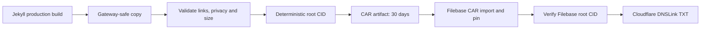

# Publishing jaack.me on IPFS

The existing GitHub Pages legacy build still serves `master` normally. A separate workflow produces a portable archive:



The pipeline copies `_site` to `_site_ipfs`, removes `CNAME`, keeps `404.html`, and rewrites root-relative HTML, CSS and manifest URLs relative to each file. Directory URLs retain their trailing slash, including home (`./`). This works on `/ipfs/<cid>/` path gateways as well as subdomain gateways. A gateway may not automatically serve our custom 404 page for missing content; `/404.html` itself remains available.

`check.mjs` rejects root-relative URL references, missing internal targets, paths escaping the archive, symlinks, forbidden publish paths, files over 25 MiB, or a total over 300 MiB. Override the budgets with positive numeric `IPFS_MAX_FILE_MB` and `IPFS_MAX_TOTAL_MB` environment variables. All JSON path strings, HTML URL attributes (including URL-bearing `data-*`), every srcset candidate, inline styles, style blocks, CSS URLs and SVG links are scanned. JavaScript string literals are audited: new root-path literals fail the build for manual, base-aware repair instead of being blindly rewritten.

## Reaching the site

After Filebase pinning and DNSLink configuration:

- `ipns://jaack.me` in Brave or another IPFS-capable client, with IPFS support enabled.
- `https://jaack-me.ipns.inbrowser.link/` for DNSLink resolution.
- `https://<cid>.ipfs.inbrowser.link/` for an immutable release.
- A Filebase dedicated gateway, using its configured `/ipfs/<cid>/` path or CID subdomain. Copy its gateway hostname from your Filebase configuration.

Public `ipfs.io` / `dweb.link` browser requests currently redirect to the service-worker gateway at `inbrowser.link`. Cloudflare's former public IPFS gateway is gone; Cloudflare here manages DNS only. DNSLink resolves the TXT record at `_dnslink.jaack.me`. If you choose a different `IPFS_DNSLINK_NAME`, clients must resolve the corresponding domain; the jaack.me examples require `_dnslink.jaack.me`.

Absolute URLs, including `https://jaack.me/...`, protocol-relative URLs, external embeds, `mailto:`, `tel:`, data URLs, fragments and existing relative paths remain unchanged. Consequently canonical metadata, sitemap/feed URLs, some images and links still refer to the live web. This archive is portable, but it does not mirror external services or guarantee a fully offline reading experience. No external sites are contacted during validation.

## Repository configuration

Add GitHub Actions repository **secrets**:

| Secret | Purpose |
| --- | --- |
| `FILEBASE_ACCESS_KEY` | Filebase S3 access key |
| `FILEBASE_SECRET_KEY` | Filebase S3 secret key |
| `FILEBASE_BUCKET` | Existing Filebase IPFS bucket name |
| `CLOUDFLARE_DNSLINK_TOKEN` | Cloudflare API token, **Zone → DNS → Edit**, scoped to **jaack.me only** |

Add repository **variables**:

| Variable | Value |
| --- | --- |
| `CLOUDFLARE_ZONE_ID` | jaack.me Cloudflare zone ID |
| `IPFS_DNSLINK_NAME` | Recommended: `_dnslink.jaack.me` |

Use an existing Filebase bucket configured for IPFS. No account or bucket creation is automated. Credentials enter the publish process through Actions secrets only; they are never written into the site or printed. There is no pruning: historical CAR objects are retained for rollback. Review storage usage periodically.

Pushes to `master`, pull requests targeting `master`, and manual workflow dispatches build an archive. Pull requests and dispatches from branches other than `master` are CAR-only: the pin and DNSLink step runs only for non-PR events on `refs/heads/master`. Actions are pinned to full commit SHAs. The workflow has read-only repository permissions and serializes publishes without cancelling a running publish. Every run writes the root CID, commit and CAR size to its job summary and retains a CAR artifact for 30 days.

Missing Filebase secrets select successful **CAR-only mode**. With all three Filebase secrets present, the preinstalled AWS CLI uploads `jaack-me/<yyyymmdd-hhmmss>-<shortsha>-<cid>.car` with S3 metadata `import=car`. It polls `head-object` for `Metadata.cid` (the `x-amz-meta-cid` header) and fails without touching DNS if it does not match the local root CID. Configured but invalid credentials are a failure, not CAR-only mode.

Only after verification, with the Cloudflare secret and both variables present, the workflow finds the exact-name TXT record starting with `dnslink=`. It creates one when absent or patches the matching record to `dnslink=/ipfs/<cid>`, TTL 300. Other TXT records remain intact; multiple matching DNSLink records fail for manual resolution. Old and new values go into the summary. Missing Cloudflare configuration leaves the verified pin intact and succeeds with a notice.

## Local validation

Requirements: Ruby 3.3 with this repository's bundled gems, Node 20+, Bash, curl, tar and shasum. On this Mac:

```sh
export PATH=/opt/homebrew/opt/ruby@3.3/bin:$PATH
bundle exec jekyll build
npm test
scripts/ipfs/dry-run.sh
# Or reuse a fresh _site:
scripts/ipfs/dry-run.sh --skip-build
```

The installer downloads **Kubo v0.43.1** for Darwin/Linux, arm64/amd64 from its GitHub release assets and verifies the tarball against that release's `.sha512` file on every run. `.tools/` is ignored by git and excluded from Jekyll. To upgrade, change the single version pin in `install-kubo.sh`, review the new release's profile semantics, and rerun all tests and the real dry run. Release checksums ensure archive integrity, rather than independently authenticating the release publisher.

Local and CI imports use Kubo's `unixfs-v1-2025` add profile, which fixes CIDv1, SHA-256, raw leaves, balanced layout, 1 MiB chunks and directory sharding parameters. Do not change import options between local and CI builds. The CID identifies the exact transformed bytes; changing the content changes it. Identical inputs and settings produce the same CID; Jekyll-generated feed timestamps can change between builds.

The dry run initializes a temporary test-profile Kubo repo, disables swarm, bootstrap and mDNS, adds twice and compares CIDs, exports a CAR, and starts a loopback-only offline gateway on random free ports. It requires HTTP 200 for home, English home, projects, Carta, about, a blog post, and 404. It fetches every same-site CSS, JS, image, font, poster and other asset reference on those pages, recursively following CSS URLs. Absolute jaack.me asset URLs are checked at their local archive equivalents without contacting jaack.me. It writes `$TMPDIR/jaack-ipfs-dry-run.json` (or `/tmp/...`) with CID, CAR bytes, page/asset counts and reproducibility status, then removes the daemon, temporary repo and CAR. CI's `prepare-car.sh` preserves its CAR at `.tools/jaack-me.car` for artifact upload.

## Published content and existing defects

The archive contains Jekyll's public site, including downloads and hidden `.well-known` content. It excludes `moxie/`, tests, scripts, docs, gem/npm dependencies, git metadata and build tools. Jekyll excludes Moxie, and the independent checker enforces that exclusion along with private inventory names from `tests/moxie-leak.test.cjs`, `.env*` (including examples), keys and certificates. Never use exclusions as a substitute for reviewing new public content. **Anything pinned is public and practically permanent**: deleting an object or moving DNS cannot remove other people's copies.

`repairs.mjs` documents a small, explicit repair table applied only to the IPFS copy. The starting site had 23 broken internal references: scheme-less external links, two outdated permalink targets, and missing image paths. Known scheme-less links keep their already-relative URL attributes and receive local HTML redirect targets to the intended HTTPS destination. Two image paths map to identifiable originals already in the repo. Four image paths have no original here (2030 poster and talk photo, AutoScan architecture, and the IPFS install cover); these use an SVG explicitly labelled “Original image unavailable in this archive.” Replace the table entries when the originals become available. The Pages source is untouched.

The source has no `/en/index.html`; the IPFS copy adds the bilingual home there so `/en/` serves the site rather than a gateway directory listing. Links in this new page are rebased from the original home; existing files keep their already-relative URL attributes.

The language switcher reads `data-alt-url`, which the HTML transform rewrites; it therefore stays inside the current CID on path gateways. No active root-relative runtime fetch/navigation paths were found in shipped JS. Audited non-URL slash strings in the BeeLine bundle (unused Vue `BASE_URL`, closing-tag construction and source-map comments) are ignored by the JS audit. Future runtime URL construction still needs review: static string scanning cannot prove the behavior of arbitrary computed JavaScript.

## Rollback

Use a previous CID from an Actions job summary or Filebase object key. Repoint the exact DNSLink TXT record to `dnslink=/ipfs/<previous-cid>` with TTL 300, using your existing DNS administration access. Confirm that the old CID remains pinned before switching. This does not change Pages or delete the newer pin.

Alternatively rerun a previous `master` workflow run for the desired commit. Dispatching on another branch produces a CAR artifact only. A new build may have a new CID because of generated timestamps, but restores that source version. The workflow verifies the new pin before changing DNS. Download CAR artifacts before their 30-day expiry; the Filebase object is retained independently.

## Optional Mac mini pin

On an already configured Kubo node, import the downloaded CAR artifact:

```sh
ipfs dag import jaack-me.car
# Or retrieve and pin a release by CID:
ipfs pin add <cid>
ipfs pin ls <cid>
```

`dag import` pins the CAR root by default; verify it with `pin ls`. This adds another provider only while the Mac mini is online, reachable, and running Kubo. It does not replace Filebase availability or update DNSLink. Do not expose a Kubo administrative API to the public internet.
